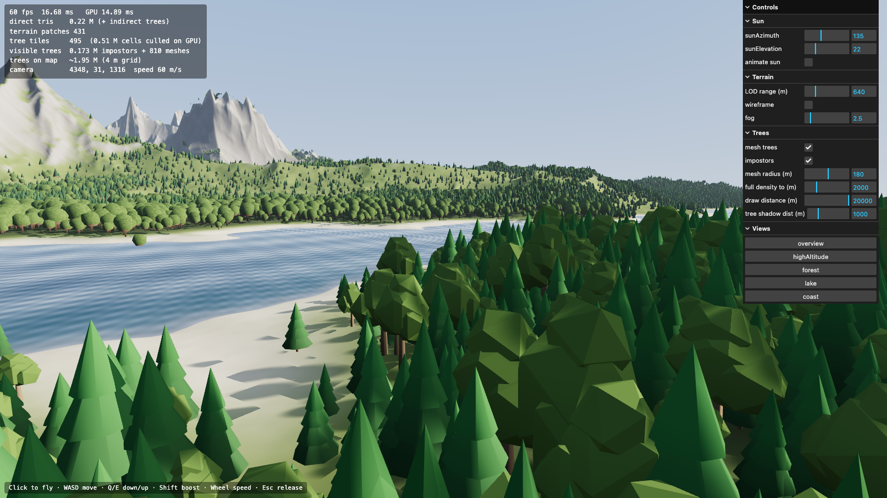
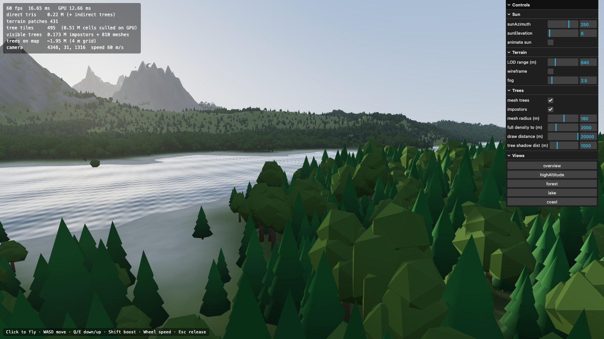

# WebGPU landscape rendering

A three.js (r186, `WebGPURenderer` + TSL) playground for high-performance open-world rendering. It targets 60+ fps on a
procedural **16 × 16 km island** (~130 km² of land) with mountains, a lake, the sea, and **~2 million trees**.




```bash
npm install
npm run dev        # http://localhost:5173  (needs a WebGPU browser: Chrome/Edge 113+, Safari 26+)
```

Click to fly · WASD · Q/E down/up · Shift ×6 boost · mouse wheel = speed. URL params: `?view=forest|lake|coast|overview|highAltitude`, `&el=6&az=250` (sun), `&aa=0`.

## How it works

| System | Technique | File |
|---|---|---|
| World | Seeded simplex fBm + ridged multifractal + domain warp, island mask, carved lake. Generated in parallel Web Workers (~2.5 s for 4096² @ 4 m). Min/max height pyramid for culling. | `src/world/` |
| Terrain | **CDLOD** (Strugar): CPU quadtree with frustum culling selects ~100–450 patches; one instanced 16×16 grid draw; vertices **geomorph** to the coarser level near range boundaries, so there are no cracks and no popping. | `src/terrain/Terrain.js` |
| Long-range shadows | GPU compute pass ray-marches the heightmap toward the sun (100 steps, geometric step growth up to ~6 km) and writes soft visibility + large-scale AO to a 2048² texture. Rebaked only when the sun moves. Mountains shadow terrain, trees and water **at any distance**. | `src/terrain/ShadowBaker.js` |
| Trees: placement | No per-tree CPU data. A tree is a pure function of its 4 m grid cell (hash + density texture), so every system agrees where trees are. | `src/shading/common.js` (`treeAt`) |
| Trees: GPU culling | Each frame: a CPU quadtree picks 32×32-cell tiles by tier. A compute pass evaluates every cell, applies distance fades and a sphere-frustum test, then **atomically appends** survivors to compact instance buffers. The atomic counters are the **indirect draw args** (`drawIndexedIndirect`). | `src/vegetation/Trees.js` |
| Trees: LOD | < 180 m: low-poly meshes (2 species). 180–600 m: opaque silhouette cards with fake volumetric normals. > 600 m: 1-triangle cards. Each tier beyond `full density` visits every 2nd cell per axis, and trees that disappear in the next tier shrink smoothly first, so there is no popping. Meshes and cards **crossfade with real alpha blending** over a 100 m band (130–230 m): the mesh fades in over the opaque card, then the card fades out over the opaque mesh, so nothing ever shows through and there is no dither noise. Far away, forests also tint the terrain. | `src/vegetation/Trees.js` |
| Tree shadows | **Procedural, no shadow map**: the terrain shader ray-sphere-tests the canopies of the cells where the sun ray crosses canopy height. Self-shadowing on mesh trees uses the same function. Beyond ~1 km this becomes statistical darkening from forest density. | `src/shading/common.js` |
| Water | Opaque. Depth from the heightmap: absorption, shore foam, sand showing through. Analytic waves that fade out per wavelength (no moiré), Fresnel sky reflection with sun glint. Mountains shadow it via the baked texture. | `src/water/Water.js` |
| Atmosphere | Analytic height fog integrated along the view ray, coloured by the same `skyColor()` as the sky dome and the reflections, so the horizon is seamless. | `src/shading/common.js` |

### Performance notes (Apple M4 base, 10-core GPU, 1600×900, MSAA 4×)

GPU time is measured with timestamp queries and shown in the HUD:

* Overview / aerial / coast: **3–6 ms**
* Lake / low-angle dense forest (worst case): **10–15 ms**

Findings so far:

* Alpha-tested impostors (`discard`) defeat hidden-surface removal on tile-based GPUs (Apple, mobile). Opaque silhouette cards fixed that.
* Sub-pixel triangles are the cost for distant trees, hence the 1-triangle far LOD.
* The terrain fragment shader is now the largest single cost.

Tools: `node scripts/screenshot.mjs [url] [views]` (headless Chrome, prints HUD and console errors) and
`node scripts/perf.mjs [view]` (per-system GPU cost breakdown). Both need the dev server running.

## Next iterations (ideas)

- Real octahedral impostors baked from the tree meshes (texture atlas), so the mesh/card crossfade blends matching silhouettes.
- Hi-Z occlusion culling of tree tiles/instances (mountains hide most of the forest at low altitude).
- Terrain: higher-frequency detail (procedural or tiled detail heightmaps), texture splatting, triplanar rock.
- Cascaded shadow map for near (<100 m) mesh trees, combined with the baked far shadows.
- More biomes, rivers, erosion simulation (GPU hydraulic erosion on the heightmap).
- Larger worlds: stream heightmap tiles / virtual texturing, floating origin.
